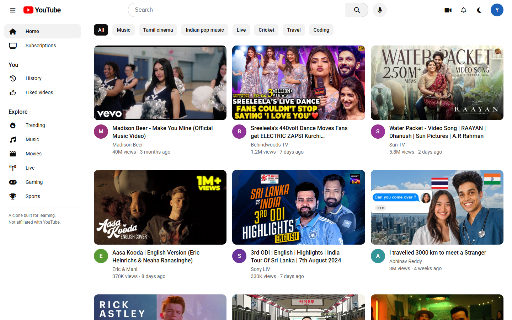
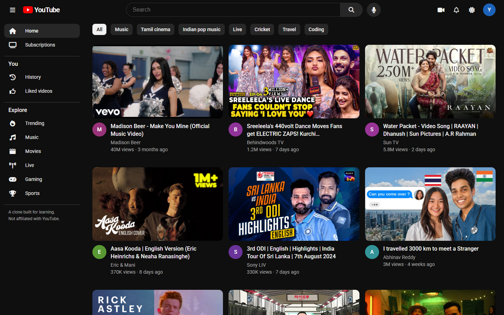
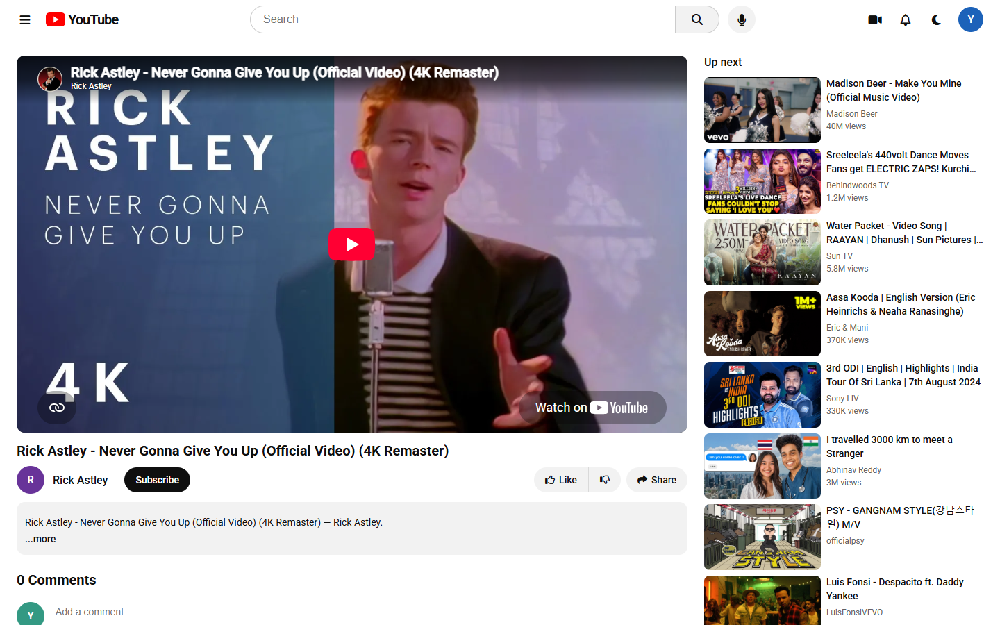
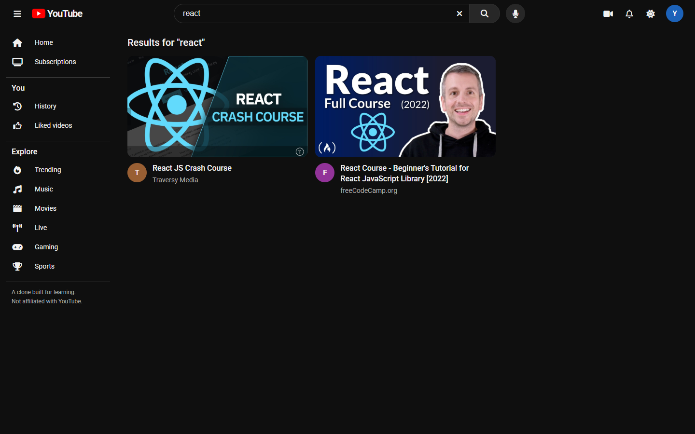
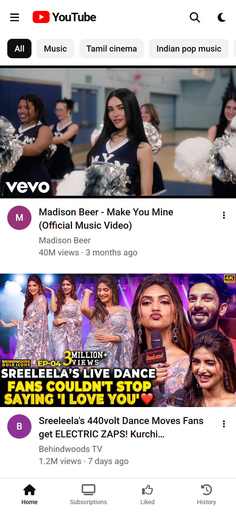
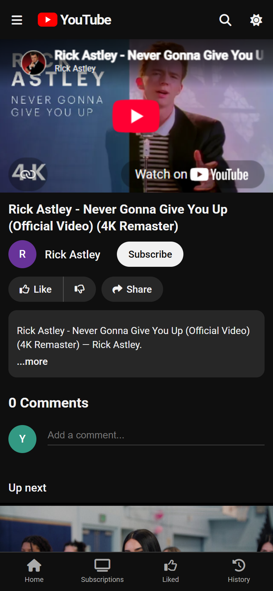

# YouTube Clone

A working YouTube clone built with plain **HTML, CSS and JavaScript**. There are no frameworks, no dependencies and no build step.

**Live demo:** https://youtube-clone-omega-sage.vercel.app/

## Screenshots

Captured from the [live site](https://youtube-clone-omega-sage.vercel.app/).

| Home (light) | Home (dark) |
| --- | --- |
|  |  |

| Watch page | Search results (dark) |
| --- | --- |
|  |  |

| Mobile home | Mobile watch page (dark) |
| --- | --- |
|  |  |

## Features

- **Home feed** with a responsive video grid, category chips and loading placeholders
- **Search** across video titles, channels and tags, plus voice search where the browser supports it
- **Watch page** with the embedded YouTube player, related videos, like/dislike, subscribe, share (copies the link), an expandable description and comments
- **Library pages:** Subscriptions, Liked videos and Watch history
- **Light and dark theme**, following your system setting or the toggle in the top bar
- **Responsive layout**
  - Desktop: full sidebar that collapses to an icon strip
  - Tablet: icon strip, with the full menu as a slide-over
  - Phone: bottom navigation, full-width cards and a pinned video player

## Tech

| Part | Used |
| --- | --- |
| Markup and styling | HTML5, CSS3 (custom properties, grid, flexbox) |
| Logic | Vanilla JavaScript, hash-based routing (`#/`, `#/watch?v=ID`, `#/search?q=...`) |
| Icons and fonts | Font Awesome, Roboto |
| Video playback | YouTube embedded player (`youtube-nocookie.com`) |
| Storage | Browser `localStorage` |

## Project structure

```
├── index.html   Page shell: top bar, sidebar, bottom nav
├── style.css    All styles, themes and responsive breakpoints
├── app.js       Router, views, search, watch page, user state
├── data.js      The list of videos
├── images/      Video thumbnails
└── screenshots/ Images used in this README
```

## Run locally

Open `index.html` in a browser, or serve the folder:

```bash
npx serve
```

## Add a video

Add an entry to the list in `data.js` and put its thumbnail in `images/`:

```js
{
    id: "dQw4w9WgXcQ",                 // YouTube video ID (the part after ?v=)
    title: "Video title",
    channel: "Channel name",
    thumb: "./images/video-title.jpg",
    tags: ["music", "pop"],            // used by search and the category chips
    description: "Short description.",
    views: 1000000,                    // optional
    published: "3 months ago"          // optional
}
```

A category chip appears automatically once at least one video has a matching tag.

## Deploy

It is a static site, so it works on Vercel, Netlify or GitHub Pages. Publish the repository root; no build command is needed.

## Notes

- Likes, subscriptions, comments and watch history are stored only in your own browser. They are not synced to YouTube or between devices.
- The videos play through YouTube's embedded player, so they need an internet connection.
- This is a learning project and is not affiliated with YouTube.
